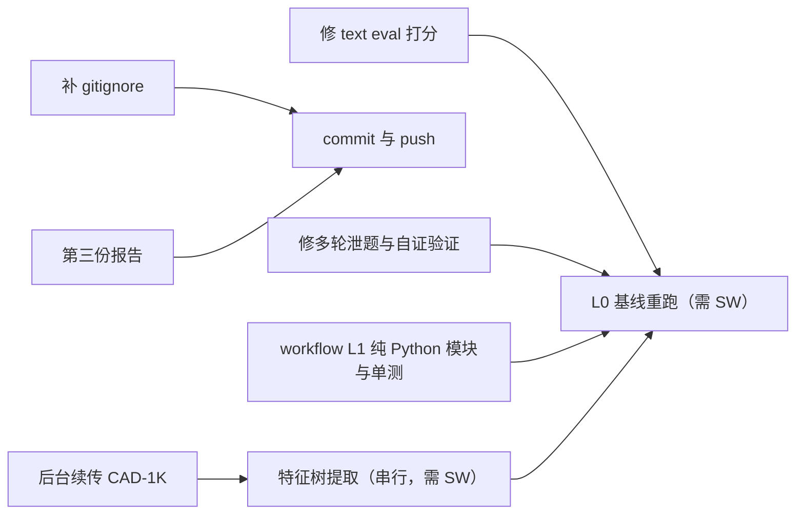

# CAD-1K 下载期间的并行修复计划

> 本文是 2026-09-28 CAD-1K 下载期间执行的计划原文，执行结果见《实施路线与CAD-1K及论文计划》。
> 讨论后确定：CAD-1K 只用于挖掘与分析，不参与评测；计划中「同样的逻辑复用给 CAD-1K」指复用特征类型统计函数，不是打分。

## 当前状态
- 上次下载是被前台等待卡住后中断的。目前 [LLMPlanner/datasets/cad1k/raw/](../LLMPlanner/datasets/cad1k/raw/) 下已有 88 个任务目录，共 110 MB，没有残留的 `.part` 文件。
- [download.py](../LLMPlanner/datasets/cad1k/download.py) 会跳过大小一致的文件，所以直接重跑就是续传。这次改成后台运行（`block_until_ms: 0`），输出写到 `log/cad1k_download.log`。
- 风险：[.gitignore](../.gitignore) 里有一条 `!LLMPlanner/**`，`raw/` 目前会被 git 跟踪。数据集没有 license，**不能入库**。所以第一步就要补上 `LLMPlanner/datasets/cad1k/raw/**`。

## 并行调度原则
- SolidWorks 只有一个实例。凡是要连 C# 服务的任务（CAD-1K 特征树提取、eval 实跑）都排成串行队列。
- 纯 Python 的任务、写文档、调 LLM 的离线任务，和下载同时进行。

## 1. 打分修复：[eval/eval_text_singleturn_qwen.py](../LLMPlanner/eval/eval_text_singleturn_qwen.py)
现在的问题：
- `_feature_metrics` 依赖 `feature_sketch_links`。这份数据只有通过 API 新建的特征才有，打开外部的 SLDPRT 时是空的，CAD-1K 也就没法用同一套指标。
- `revolves`、`polygons` 这几项按“成功的操作次数”计数，不看最终几何，模型可以刷分。
- 执行分 = 成功步数 / 模型自己计划的步数。这是自证式的：计划写得越短越容易拿满分。
- `sorted(bbox)` 忽略了朝向。这点可以保留为默认，但要加一个严格模式的开关。

修法：
- 新建 `eval/metrics.py`，所有指标只从 `features[].type`（`GetTypeName2`）统计：
  - `Extrusion` / `ICE` 算拉伸，`Cut` 算切除，`Revolution` / `RevCut` 算旋转；
  - `Fillet`、`Chamfer`、`HoleWzd`、`Shell` 各自计数；
  - `LPattern` / `CirPattern` / `MirrorPattern` 算阵列与镜像。
  - 同样的逻辑复用给 CAD-1K。
- 执行分改成两项：“最终模型是否有有效实体”和“失败或修复的轮数”。不再用计划步数当分母。
- 结果 JSON 增加 `pass@k`（`--repeats k`）、tokens、耗时、花费，并给出 bootstrap 置信区间，按 case 汇总。
- 旧的打分函数保留为 `score_case_v1`，报告里写明两版分数的差异。

## 2. 多轮评测的泄题和自证验证
- 在 [planner/llm_client.py](../LLMPlanner/planner/llm_client.py) 第 1114 行附近，`current_milestone.model_dump` 会把 postconditions 里的期望值原样发给 LLM。
- 修法：拆成“公开字段”（id、描述、kind）和“隐藏字段”（期望数值）。LLM 只能看到公开字段。修复模式下的 `evidence` 只给定性差异，比如“X 方向偏大”，不给目标数值。这个行为通过开关 `hide_targets=True` 控制，评测时默认开启。
- 验收改成只依据 eval spec / GT（例如 [eval/*_spec.json](../LLMPlanner/eval)），不再依据模型自己生成的 blueprint。blueprint 验证只作为过程信号记录，不计入分数。
- 补一个单测：断言 prompt 中不出现 GT 数值。

## 3. CAD-1K 特征树提取：新建 `datasets/cad1k/extract_features.py`
- 下载期间先写好，然后在已经下完的 88 个任务上跑。
- 对每个任务：
  1. 调 `/api/close-all-documents`；
  2. 调 `/api/open-part` 打开 `output_files/output.sldprt`；
  3. 取 `/api/model-observation`；
  4. 调 `/api/export-step` 导出 STEP；
  5. 结果写到 `raw/{id}/features.json`。
- 记录打开时的 errors/warnings，用来判断 SW2025 的版本兼容性；打开失败就跳过并记入 manifest。
- 汇总统计写到 `datasets/cad1k/stats.json`（只含派生统计，可以入库），包括：特征类型分布、每个模型的特征数、rubric 条数、narration 的动作分布。这些统计是后面挖掘工具库的输入。
- 对齐方式：用 narration 的 `start_s/end_s` 对特征序号做粗对齐，作为后续挖掘 workflow 的素材。第一版只输出对齐表，不做学习。

## 4. workflow L1 里不需要 SolidWorks 的部分：`planner/workflow/`
- `params.py`：参数表加表达式求值（安全 AST，只允许四则运算、函数和参数名引用），支持单位 mm 到 m 的转换。
- `sketch_check.py`：用 shapely 预检草图，检查闭合、自交、孔是否在轮廓内、最小壁厚。返回标准化的错误码。
- `refs.py`：语义面引用（`base.top`、`base.face(+Z)`、`H1`）。解析逻辑基于 `observation.faces` 的法向和位置，是纯函数，可以用录下来的 observation 做单测。
- 以上都配 pytest 单测，放在 [LLMPlanner/test/](../LLMPlanner/test)。
- 真正接到 SolidWorks 的 tools 和 stages 等 SW 队列空闲后再做。

## 5. 第三份报告：`docs/实施路线与CAD-1K及论文计划.md`
- W0–W4 各自对应要改的文件，并标出当前进度（W0 拆分已完成，commit 74a75c1）。
- CAD-1K 的用法：
  - 特征树、narration、事件三方对齐；
  - 训练集和测试集划分，CAD-1K 只用于挖掘和分析，不作为测试集，避免污染；
  - license 风险，需要联系 markov-ai 确认。
- 论文和 benchmark 的计划：Text2CAD 优先，再扩展到三视图；L0–L4 消融；可编辑性测试；隐藏 GT；pass@k；目标是 CVPR。
- 本计划本身也另存到 `docs/`。

## 6. 提交节奏
每完成一项就 commit 并通过 SSH push 到 `git@github.com:fansunqi/SolidWorksTutorial.git`。gitignore 修复必须最先提交，之后才能执行任何 `git add`。
