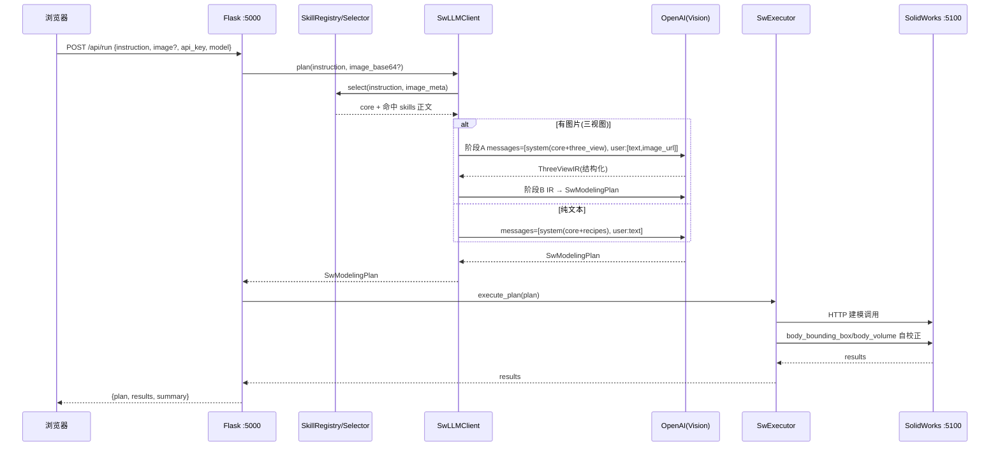

# 多模态图纸 → 建模 功能规划

> **状态**：已由早期"通用多模态图片建模"草案演进为「**三视图聚焦 + Skill 化 Prompt 架构 + 数据集金字塔**」的完整规划（2026-07 更新）。
> 本文档来源于 CodeBuddy Plan Mode 生成的实施计划，与 `.codebuddy` 计划状态一一对应。

---

## 演进说明

**初版方案（已归档）**：
- 输入：手绘草图 / 三视图 / 效果图，全部支持
- 实施：直接在硬编码 `SYSTEM_PROMPT` 末尾追加"图纸分析指导"
- 改动点：5 步（llm_client / app.py / index.html / style.css / app.js）
- 缺点：多类型图纸精度不可控（尤其手绘无尺寸）；SYSTEM_PROMPT 越加越臃肿、维护困难

**当前方案（本文档）**：
1. **多模态输入聚焦"带尺寸标注的三视图"**——它是三种输入里唯一"精度可控 + 与现有 sketch→extrude 管线天然同构"的形态；手绘草图、工程图暂不做，为它们在 skill 架构里预留 `input_modes/` 扩展位。
2. **Prompt 架构升级为 Skill 动态加载**：`core` 只保留通用规则，`recipes` 只允许参数化能力模式，`input_modes` 描述输入解释方法；禁止按物体或 benchmark 保存答案。
3. **测例采用金字塔结构（Tier S/A/B/C）**：Tier S 用公开数据集 **TriView2CAD**（20 万三视图 PNG + DXF + 尺寸标注 + STEP GT）做端到端评测主力；Tier A 用 **CAD-VGDrawing** 走 SVG 直读路径；Tier B/C 为自建手工/合成测例。

---

## 产品概述

为现有 SolidWorks LLM 自动建模系统加入**多模态图纸建模能力**，第一期聚焦「带尺寸标注的三视图」输入：用户上传一张标注了尺寸的三视图图片（主视图/俯视图/侧视图），系统识别几何轮廓与尺寸，自动生成建模计划并在 SolidWorks 中建出对应零件。

同时对现有「每次直接改硬编码 SYSTEM_PROMPT」的维护方式做架构升级：将约 400 行的单体 Prompt 拆解为**文件驱动的 Skill 体系**，新增/修改建模知识只需增删一个 Markdown 文件，无需改动 Python 代码。

## 核心功能

### 一、Skill 动态加载架构（Prompt 优雅化）

- Prompt 拆分为 `core`（操作、单位、坐标、拓扑约束）与 `recipes`（阵列、薄壁、旋转等可迁移能力模式）两类 Skill 文件
- 每个 Skill 为带 YAML frontmatter 的 Markdown（name/description/triggers/applies_to + 正文）
- 运行时按用户指令/图片元信息轻量路由，选出相关 Skill，动态拼装成最终 System Prompt
- 新增知识前先归类通用能力缺口；Skill 不能包含评测 case 的完整步骤或固定答案

### 二、三视图多模态建模（第一期范围）

- 前端支持上传三视图图片（可附文字补充），对话区展示图片缩略图
- 两阶段流水线：视觉模型先输出**结构化中间表示 IR**（零件类型、各视图轮廓、逐条枚举的尺寸、孔/圆角等特征），再由 IR 生成 `SwModelingPlan`
- 视图与基准面约定：主视图→前视面、俯视图→上视面、侧视图→右视面，深度维度取自相邻视图
- 建模范围限定为**以拉伸/旋转为主的 2.5D 单体零件**（L 型支架、法兰、垫片、带孔板、阶梯轴等），不涉及自由曲面与装配
- 建模完成后调用已有 `body_bounding_box` / `body_volume` 与 IR 声明尺寸对比，做尺寸自校正提示
- **双输入通道**：既支持位图图片（拍照/截图，走 Vision）也支持 **SVG/DXF 矢量图**（走"矢量结构解析"直读几何——这条路径不需要 Vision 模型，天然精确，特别适合对接 CAD-VGDrawing / TriView2CAD 这类矢量数据集做批量 benchmark）

### 三、体验一致性

- 三视图分析结果沿用现有「AI 计划卡片 + 执行步骤 + 完成摘要」展示流程
- Skill 与 TEST.md case 必须解耦；回归 case 可具体设计，但答案不得进入生产 Skill

## 技术栈

- **后端**：现有 Flask（`web/app.py`）+ Python planner 模块，无新增框架
- **LLM 调用**：现有 OpenAI Python SDK，三视图使用 Vision（base64 data URI 放入 `messages` 的 `image_url`）
- **结构化输出**：现有 Structured Outputs（`json_schema`）+ JSON mode 降级，新增 IR 用 Pydantic 定义
- **Skill 存储**：Markdown + YAML frontmatter（`pyyaml`，已在 venv 生态内，若无则加入 requirements）
- **图片处理**：前端 Canvas 压缩 + `FileReader` 转 base64，后端仅 base64 透传，无需 Pillow
- **缓存**：现有 diskcache，缓存 key 纳入「组装后 Prompt 哈希 + 图片哈希」，Skill 组合或图片变化自动失效

## 实现方案

### 整体策略：两步走，先重构后叠加

**第一步（零行为变更的 Skill 重构）**：把 `llm_client.py` 中约 400 行硬编码 `SYSTEM_PROMPT` 原样搬运拆分到 `planner/skills/` 下的 md 文件，引入 `SkillRegistry`（扫描解析）+ `SkillSelector`（路由）+ `build_system_prompt()`（拼装）。用现有回归测试（`test_dice_full` / `test_stool_llm` / `test_key_llm` 等）验证生成计划与拆分前一致。此步不碰多模态。

**第二步（叠加三视图能力）**：新增三视图 IR 的 Pydantic 模型与两阶段规划方法；`plan()` 增加 `image_base64` 可选参数；三视图作为 `input_modes/three_view.md` 一个 Skill 落地。多模态与 Skill 架构收敛为同一机制。

### 关键技术决策

1. **为何先做「带尺寸三视图」而非草图/工程图**

- 三视图有明确尺寸标注 → 精确可复现（效果最好）；与现有 `select_plane → sketch → feature_extrusion` 管线天然同构，落地风险低
- 手绘草图无精确尺寸，效果差；工程图是三视图超集（含剖视/公差/多零件），复杂度高。二者放二期，但 Skill 架构已为其预留 `input_modes/` 扩展位

2. **两阶段（IR 中间层）优于"图片直接出 Plan"**

- 阶段 A：Vision 模型只做"看图 → 结构化 IR"（零件类型 + 各视图轮廓 + **逐条枚举尺寸** + 孔/圆角特征），职责单一、可校验
- 阶段 B：IR → `SwModelingPlan`，复用现有成熟的文字建模能力
- 好处：IR 可打印/校验/缓存，出错时定位在"看图错"还是"建模错"一目了然；避免让模型一步到位既读图又排 50 步计划导致不稳定

3. **Skill 路由采用轻量优先、LLM 兜底**

- 先用 frontmatter 的 `triggers` 关键词 + `description` 做本地匹配挑 top-K；命中不明确时可选一次极小的 LLM 路由调用
- `core` Skill 恒定全量注入（通用规则不可省），仅 `recipes` / `input_modes` 走路由，控制 Prompt 体积与 token 成本

4. **向后兼容与缓存**

- `plan(user_instruction, image_base64=None, ...)` 新参数全部 Optional，不传时行为与现状完全一致
- `/api/run` 不传 `image` 时走原纯文本路径
- `_make_cache_key` 从"整段 SYSTEM_PROMPT 哈希"改为"实际组装后的 Prompt 哈希（含命中 Skill 列表）+ 图片哈希"，组合变化自动失效，避免命中旧计划

5. **建模精度保障（沿用项目既有经验）**

- `temperature=0`、`max_tokens=16000`、"禁止省略、必须全枚举"规则移入 `core` Skill
- 三视图 Skill 内强制"先逐条枚举所有尺寸再排步骤"，并写清视图↔基准面映射与"深度取自相邻视图"规则
- 收尾用 `body_bounding_box`/`body_volume` 与 IR 尺寸对比自校正

### 数据流



### 目录结构

```
LLMPlanner/
├── planner/
│   ├── skills/                     # Skill 文件根目录（文件驱动，按通用能力扩展）
│   │   ├── core/
│   │   │   ├── 00_operations.md    # [NEW] 可用操作及参数（从 SYSTEM_PROMPT 搬运）
│   │   │   ├── 01_units.md         # [NEW] 单位换算规则（搬运）
│   │   │   ├── 02_rules.md         # [NEW] 重要规则/坐标映射/全枚举约束（搬运）
│   │   │   └── 03_editing.md       # [NEW] 编辑已有模型规则/modify_dimension（搬运）
│   │   ├── recipes/                # 参数化能力模式，不存放物体答案
│   │   └── input_modes/            # [NEW] 输入模态 Skill（预留 sketch/engineering 扩展位）
│   │       └── three_view.md       # [NEW] 三视图建模：视图↔基准面映射、先枚举尺寸、深度取相邻视图、自校正
│   ├── skill_registry.py           # [NEW] SkillRegistry：扫描 skills/ 解析 frontmatter+正文；SkillSelector.select() 路由；build_system_prompt(core+命中skills)
│   ├── schemas.py                  # [MODIFY] 新增三视图 IR 模型：ThreeViewIR(part_type/views[]/dimensions[]/features[])、ViewProfile、DimensionSpec 等 Pydantic 模型
│   ├── llm_client.py               # [MODIFY] 移除硬编码 SYSTEM_PROMPT（迁至 skills/）；plan() 加 image_base64 参数；新增 _build_user_message()(Vision 格式)、_plan_three_view()(两阶段:先出IR再出Plan)；接入 SkillRegistry 组装 prompt；_make_cache_key 纳入组装后prompt哈希+图片哈希
│   └── executor.py                 # [MODIFY] 可选：新增 verify_against_ir() 便捷方法，封装 body_bounding_box/body_volume 与 IR 尺寸对比（也可留在 llm_client 收尾逻辑中）
├── web/
│   ├── app.py                      # [MODIFY] /api/run 提取请求体 image 字段，透传 llm_client.plan(instruction, image_base64)
│   └── static/
│       ├── index.html              # [MODIFY] 输入区加图片上传按钮+预览区；示例区加"三视图建模"按钮
│       ├── style.css               # [MODIFY] 上传按钮/缩略图预览/用户气泡图片/拖拽高亮样式
│       └── app.js                  # [MODIFY] 图片选择/压缩/base64；send() 附带 image；appendUser() 渲染图片；拖拽上传
├── requirements.txt                # [MODIFY] 如缺则补 pyyaml
├── README.md                       # [MODIFY] 补充 Skill 架构说明 + 三视图多模态用法
└── TEST.md (根目录)                # [MODIFY] 收录三视图建模任务 prompt 与验证点（遵守项目约定）
```

### 关键代码结构

```python
# schemas.py — 三视图中间表示（IR），阶段 A 的结构化输出
class DimensionSpec(BaseModel):
    label: str          # 尺寸标注名（如 "总长" "孔径"）
    value_mm: float     # 数值（毫米，阶段B统一 ÷1000 转米）
    applies_to: str     # 作用对象（如 "front.width" "hole1.diameter"）

class ThreeViewIR(BaseModel):
    part_type: str                  # 零件类型（extrude_prism / revolve / plate_with_holes ...）
    base_view: str                  # 主视图对应基准面（front/top/right）
    profiles: list[dict]            # 各视图轮廓的结构化描述
    dimensions: list[DimensionSpec] # 逐条枚举的全部尺寸
    features: list[dict]            # 孔/圆角/倒角等附加特征
    assumptions: str                # 缺失尺寸时的合理假设说明
```

```python
# llm_client.py — 方法签名（新参数均 Optional，向后兼容）
def plan(self, user_instruction: str, image_base64: Optional[str] = None) -> SwModelingPlan: ...
def _build_user_message(self, text: str, image_base64: Optional[str] = None) -> dict: ...
def _plan_three_view(self, text: str, image_base64: str) -> SwModelingPlan: ...  # 两阶段:先IR后Plan
```

```python
# skill_registry.py — Skill 组装（文件驱动）
class SkillRegistry:
    def load(self) -> None: ...                      # 扫描 skills/ 解析 frontmatter+正文
class SkillSelector:
    def select(self, instruction: str, image_meta: Optional[dict]) -> list[Skill]: ...  # 轻量路由 top-K
def build_system_prompt(core: list[Skill], picked: list[Skill]) -> str: ...  # core 全量 + 命中 skill 正文
```

## 测例与数据集

### 一、公开数据集调研结论

经调研以下五个相关数据集/论文：

| 数据集 | 论文 / 来源 | 规模 | 输入格式 | 有尺寸标注？ | CAD GT 格式 | 许可 | 与我们场景匹配度 |
|---|---|---|---|---|---|---|---|
| **TriView2CAD** | CReFT-CAD (arXiv:2506.00568, 2025) | 20 万合成 + 3000 真实 | **PNG 位图三视图 + DXF 矢量** | **✅ 有精确尺寸标注** | JSON(15维参数) + DXF + **STEP** + B-Rep | 未声明(学术公开) | ⭐⭐⭐⭐⭐ **完美匹配** |
| **CAD-VGDrawing** | Drawing2CAD (arXiv:2508.18733, ACM MM 2025) | 15 万+ 对 | SVG 矢量四视图 | ❌ 无尺寸标注 | DeepCAD 序列 (.h5) | **MIT** | ⭐⭐⭐⭐ 矢量路径 |
| **OrthoCAD-322K** | ScienceDirect 2025 | 32.2 万模型 | 标准正交+等轴测视图 | 未确认 | 多种 3D 格式 | 未确认 | ⭐⭐⭐ 检索任务(非生成) |
| **Sketch2CAD** | SIGGRAPH Asia 2020 (UCL) | 1万协议→4万形状 | 渲染位图线图(非三视图) | ❌ 无 | 参数化 CAD 脚本 | 未声明 | ⭐⭐ 交互草图≠三视图 |
| **DeepCAD** | ICCV 2021 | 17.8 万模型 | 无图纸(纯 CAD 序列) | N/A | JSON 序列 | MIT | ⭐ 上游基础 |

**结论**：

- **首选 TriView2CAD**（唯一同时满足"三视图布局 + 精确尺寸标注 + STEP/DXF GT + 大规模"的数据集）作为主力 benchmark
- **次选 CAD-VGDrawing** 用于 SVG 直读路径的几何精度评测（MIT 许可清晰，几何无损）
- Sketch2CAD 为"交互式草图建模"场景（一笔一笔画并逐步建模），与我们"上传完整三视图一键建模"的交互方式不同，不适合直接用作测例
- OrthoCAD-322K 是检索任务数据集（给图找已有 3D 模型），非生成任务，暂不采用

### 二、测例金字塔（四层结构）

| 层级 | 数据来源 | 用途 | 规模 | 输入形态 | 有尺寸标注 | 许可 |
|---|---|---|---|---|---|---|
| **Tier S** | **TriView2CAD** | ⭐ 主力 benchmark（含尺寸的三视图端到端评测） | 200 + 30（从 20 万中采样简单件） | PNG 位图三视图 + DXF 矢量 | ✅ 精确 | 学术公开 |
| **Tier A** | **CAD-VGDrawing** | SVG 直读路径评测（几何精度/无 Vision） | 100~150（子采样） | SVG 矢量四视图 | ❌（几何精确靠坐标） | MIT |
| **Tier B** | **手工标注三视图**（自建） | 中文场景 demo / Vision 能力验证 | 10~20 | PNG/JPG 含标注 | ✅ 毫米 | 自产 |
| **Tier C** | **合成三视图**（脚本生成） | CI 快跑 + 覆盖率 | 30~50 | SVG+PNG 双出 | ✅ | 自产 |

四层测例都写死在 `LLMPlanner/datasets/` 下按目录组织，测试脚本按目录批量跑，产出统一的 metrics 报告。

### 三、Tier S：TriView2CAD（⭐ 最佳匹配公开数据集）

**为什么它是首选**（论文 CReFT-CAD，arXiv:2506.00568，2025；仓库 github.com/KeNiu042/CReFT-CAD；数据集托管在 ModelScope: zhuofanChen/TriView2CAD）：

1. **✅ 含精确尺寸标注**——唯一同时提供"三视图位图 + 尺寸标注 + 3D GT"的大规模公开数据集，可直接对标我们"带尺寸标注的三视图→CAD"全管线。
2. **六模态齐备**：每个样本同时提供 PNG 三视图位图、DXF 矢量图纸、15 维参数 JSON、STEP 3D 模型、B-Rep、可执行 FreeCAD 脚本 —— 可用 PNG 跑 Vision 路径、用 DXF 跑矢量路径、用 STEP 做体积/几何对比。
3. **规模极大**：20 万合成 + 3000 真实世界样本（真实样本含现实噪声：重叠标注/遮挡，用于验证鲁棒性）。
4. **零件类型匹配**：结构件（预制桥墩零件），以拉伸为主的 2.5D 件，正是我们第一期范围。
5. **任务天然对齐**：论文核心任务之一是 "Dimension Recognition and Mapping"（从三视图识别尺寸并映射到几何特征），正是我们 IR 阶段 A 的目标。

**关键格式细节**：

| 模态 | 格式 | 我们的用法 |
|---|---|---|
| 三视图位图 | PNG（高分辨率，FreeCAD 渲染） | 喂 Vision 模型（主评测路径） |
| 矢量图纸 | DXF（ezdxf 生成） | 用 `ezdxf` 直读几何+尺寸文本（对比路径） |
| 参数表 | JSON（15 维） | groundtruth 对比建模参数 |
| 3D 模型 | STEP | pythonOCC/FreeCAD 计算体积、bbox 做精确打分 |
| 脚本 | FreeCAD Python | 可选：作为 operation 序列参考 |

**子集抽样策略**：从 20 万合成中抽 200 个参数复杂度低的作为"合成 benchmark"，从 3000 真实中抽 30 个"噪声适中"的作为"真实 benchmark"；按几何复杂度分 easy/medium/hard 三档。

**⚠️ 需在执行时确认**：许可证（仓库未声明 License 但数据已在 ModelScope 公开且论文标注 open-source，采样评测属学术合理使用，不重新分发原始数据）；投影角法（第一角/第三角）需看实际 PNG 后写入 `three_view.md`。

**引用**：
```bibtex
@article{niu2025creftcad,
  author = {Niu, Ke and Chen, Zhuofan and Yu, Haiyang and Chen, Yuwen and Fu, Teng and Zhao, Mengyang and Li, Bin and Xue, Xiangyang},
  title  = {CReFT-CAD: Boosting Orthographic Projection Reasoning for CAD via Reinforcement Fine-Tuning},
  journal= {arXiv preprint arXiv:2506.00568},
  year   = {2025},
}
```

---

### 四、Tier A：CAD-VGDrawing（SVG 矢量路径评测）

**为什么选它**（论文 arXiv:2508.18733，ACM MM 2025，仓库 github.com/lllssc/Drawing2CAD）：

1. **规模足够**：15 万+ 对图纸↔参数化 CAD，够抽任何我们需要的子集
2. **格式极其匹配**：**SVG 矢量四视图**（Front/Top/Right/FrontTopRight），四视图正好对应我们的前/上/右基准面约定
3. **CAD 端是 DeepCAD 序列**（Sketch=Line/Arc/Circle 基元 + Extrude 操作），与我们现有 21 个 operation 中的 `sketch_line/arc/circle + feature_extrusion/cut_extrusion` **同构可映射**
4. **MIT 许可**，可直接引入项目并二次分发衍生数据
5. **可自动打分**：每对样本自带 ground-truth CAD 序列，可直接与我们生成的 `SwModelingPlan` 做步数/几何两级对比

**⚠️ 关键限制与应对**（README 明确 SVG 只保留了简化路径 + viewBox 归一化，**不含尺寸标注文本**）：

- **应对 1（推荐主路径）：SVG 直读，不走 Vision**。用 `svgpathtools` / `xml.etree` 解析 SVG，直接抽出每条 path 的坐标与拓扑，产出 IR。既避免 Vision 模型看图误差，又天然精确到浮点。**这条路径成为 CAD-VGDrawing 的主评测路径。**
- **应对 2（Vision 对比路径）：CairoSVG 渲染为 224×224 PNG（Drawing2CAD 原文的评测方式）再喂 Vision**。用于对比"Vision 看图" vs "SVG 直读"的差距，验证视觉管线本身能力。
- **应对 3（绝对尺寸恢复）**：SVG 归一化后几何是相对比例，绝对尺寸需要一个"总长度提示"。约定：`ThreeViewIR.overall_size_mm` 字段可从三处任一取值——(a) 用户在 web 输入框补一句"总长 100mm"；(b) 从数据集的 CAD-vec 反解出 bbox；(c) 默认约定"最长边 = 100mm"缩放。评测时用 (b) 保证公平。

**子集抽样策略**（不训练模型，只做评测，抽取即可）：

- 只抽**单 Sketch + 单 Extrude / Cut**的样本（DeepCAD 中约占 40%），命中我们第一期"2.5D 单体零件"范围
- 按 sketch 基元数量分档：`easy`(≤6 条基元) / `medium`(7~15) / `hard`(16~30)，每档取 30~50 个 → 首批 benchmark ≈ 100~150 个样本
- 二期再扩到多 Sketch 组合与 Revolve 类样本

**下载与准备脚本**：

```
# LLMPlanner/datasets/cad_vgdrawing/prepare.py
# 1) 从 Google Drive / HF 拉取 svg_raw + cad_vec 打包（README 中 "Download data from here" 链接）
# 2) 用 h5 读 cad_vec 计算每个样本的复杂度（sketch 基元数 + extrude 次数）
# 3) 按复杂度筛选并采样出 easy/medium/hard 三档
# 4) 输出 index.json 供 benchmark 脚本使用
```

### 五、Tier B：手工标注三视图（demo 与 Vision 验证）

弥补 CAD-VGDrawing 无尺寸标注 + 无中文场景的两个短板。10~20 个 PNG，覆盖用户直觉能验证的常见零件：

| 编号 | 零件 | 关键特征 | 期望 operations |
|---|---|---|---|
| B01 | L 型支架 | 拉伸主体 + 两个安装孔 | rectangle + extrusion + 2×circle + cut_extrusion |
| B02 | 圆形法兰 | 圆盘 + 4 个螺栓孔 + 中心通孔 + 倒角 | circle + extrusion + 5×cut + chamfer 或 circular_pattern |
| B03 | 带凸台垫片 | 圆环 + 顶面凸台 | 2×circle + extrusion + 顶面 circle + extrusion |
| B04 | 阶梯轴 | 3 段不同直径 | Revolve 半截面 |
| B05 | 带槽平板 | 矩形 + 长槽切除 | rectangle + extrusion + sketch_slot + cut |
| B06 | 六角螺母 | 正六边形 + 中心通孔 + 倒角 | polygon + extrusion(midPlane) + 顶面 circle + cut_extrusion(through_all) + chamfer |
| B07~B10 | 现有 dice/stool/key/box 复现 | 已知答案 | 已有基线 |
| B11~B20 | 阶梯拓展 | 组合特征 | 探索模型上限 |

图片规范（写死进 `input_modes/three_view.md`）：

- 三视图**按第三角画法**（这是国内标准），布局固定为"主视图在左上、俯视图在左下、右视图在右上"
- 每张 PNG **必须**包含至少一条尺寸标注（数字 + 单位 mm），字号 ≥14px 保证 Vision 模型可读
- 分辨率不小于 1024×768，白底黑线，避免灰底/复杂背景干扰 Vision

存放位置：`LLMPlanner/datasets/manual_three_view/{part_id}/{drawing.png, groundtruth.json}`，groundtruth 记录期望的关键尺寸（长/宽/高/孔径）、包围盒和体积，供自校正比对。

### 六、Tier C：合成三视图（覆盖率与 CI 快跑）

程序化生成 SVG 三视图 + PNG 渲染 + groundtruth，全离线可控：

- 用 Python 随机组合：`rectangle | circle | polygon | slot` × `拉伸厚度` × `0~3 个孔` × `是否圆角/倒角`
- 每个样本同时产出 SVG（Tier A 通道）+ PNG（Tier B 通道）+ 完整 groundtruth，可同时验证两条路径
- CI 用（每次改 skill/代码跑一遍）：**30 个易样本 + 10 个中样本**，5 分钟内跑完

### 七、评测指标（四层测例统一口径）

沿用 Drawing2CAD / CReFT-CAD 论文与 CAD 生成领域主流指标，同时结合我们**能真正在 SolidWorks 里建出来**的独特优势：

| 指标 | 说明 | 目标 |
|---|---|---|
| **Plan-Level Success Rate** | 生成的 `SwModelingPlan` 每一步都被 executor 成功执行的比例 | Tier S/B/C ≥ 90%；Tier A ≥ 70% |
| **Dimensional Accuracy** | 建模后 `body_bounding_box` 三轴尺寸与 groundtruth 相对误差 ≤ 2% 的样本占比 | Tier S ≥ 80%；Tier B/C ≥ 85% |
| **Volume Accuracy** | `body_volume` 与 groundtruth 相对误差 ≤ 5% 的样本占比 | Tier S ≥ 75%；Tier B/C ≥ 85% |
| **Parameter Match Rate** | 生成 plan 关键参数与 TriView2CAD 15 维 JSON GT 逐项误差 ≤ 3% 的比例（Tier S 独有） | ≥ 70% |
| **Command Match F1** | 生成 plan 的 operation 序列与 groundtruth 序列的 F1（Tier A 独有） | ≥ Drawing2CAD 论文的 baseline |
| **Feature Count Match** | 关键特征数量（孔数/圆角数）与 groundtruth 一致的样本占比 | ≥ 90% |
| **人工可用性打分** | Tier B 每个样本人工目视 1~5 分（是否长得像目标零件） | 平均 ≥ 4.0 |

### 八、目录与流程（写入 planner 目录结构）

```
LLMPlanner/
├── datasets/                       # [NEW] 测例根目录
│   ├── triview2cad/                # Tier S（⭐主力，prepare.py 从 ModelScope 拉取+采样）
│   │   ├── prepare.py              # 从 ModelScope 下载 + 复杂度筛选 + 分 easy/medium/hard
│   │   ├── index.json              # 子集清单（sample_id → png_path, dxf_path, step_path, params_json）
│   │   └── README.md               # 引用 CReFT-CAD 论文 + 许可说明
│   ├── cad_vgdrawing/              # Tier A（SVG 直读路径评测，prepare.py 拉取+采样，本身不入库）
│   │   ├── prepare.py              # 从上游拉取 + 复杂度筛选 + 采样出 easy/medium/hard
│   │   ├── index.json              # 子集清单（sample_id → svg_path, cad_vec_path, complexity）
│   │   └── README.md               # 引用 Drawing2CAD 论文 + MIT 许可说明
│   ├── manual_three_view/          # Tier B（10~20 个手工样本，入库）
│   │   └── B01_l_bracket/
│   │       ├── drawing.png
│   │       └── groundtruth.json    # {expected_bbox_mm, expected_volume_mm3, dimensions[]}
│   └── synthetic_three_view/       # Tier C（synth.py 一键生成，产物不入库）
│       └── synth.py
├── benchmarks/                     # [NEW] 评测脚本
│   ├── run_tier_s.py               # 对 TriView2CAD 子集批量跑（PNG Vision + DXF 直读双路径）
│   ├── run_tier_a.py               # 对 CAD-VGDrawing 子集批量跑（SVG 直读路径）
│   ├── run_tier_b.py               # 对手工样本批量跑（Vision 通道）
│   ├── run_tier_c.py               # CI 快跑
│   └── metrics.py                  # 上述指标的统一计算
└── ...
```

### 九、许可与合规

- **TriView2CAD**：仓库未显式声明 License，但数据已在 ModelScope 公开且论文明确标注 open-source。项目仅采样子集用于**评测**（学术合理使用），不重新分发原始数据。执行阶段需再次确认许可条款。
- **CAD-VGDrawing** 为 **MIT**，允许商用/衍生。项目仅使用采样子集，不重新分发原始数据文件（`prepare.py` 现拉现用），并在 `datasets/cad_vgdrawing/README.md` 显式引用原论文与仓库。
- **DeepCAD** 上游为 MIT，同上。
- 手工样本 B01~B20 与合成样本均为项目自产，随仓库以项目许可发布。
- 引用格式（写入 README.md 与 datasets 目录 README）：

```bibtex
@inproceedings{qin2025drawing2cad,
  author = {Qin, Feiwei and Lu, Shichao and Hou, Junhao and Wang, Changmiao and Fang, Meie and Liu, Ligang},
  title  = {Drawing2CAD: Sequence-to-Sequence Learning for CAD Generation from Vector Drawings},
  booktitle = {Proceedings of the 33rd ACM International Conference on Multimedia},
  year   = {2025},
  doi    = {10.1145/3746027.3755782},
}

@article{niu2025creftcad,
  author = {Niu, Ke and Chen, Zhuofan and Yu, Haiyang and Chen, Yuwen and Fu, Teng and Zhao, Mengyang and Li, Bin and Xue, Xiangyang},
  title  = {CReFT-CAD: Boosting Orthographic Projection Reasoning for CAD via Reinforcement Fine-Tuning},
  journal= {arXiv preprint arXiv:2506.00568},
  year   = {2025},
}
```

### 十、Sketch2CAD 评估（结论：不适合本项目测例，可参考方法）

**Sketch2CAD**（SIGGRAPH Asia 2020，UCL / Microsoft Research Asia / Inria）是"交互式逐笔画草图→CAD"系统，不适合直接作为测例：
- 输入为**渲染位图线图**（非三视图，也无尺寸标注）
- 操作是"逐步添加/切除/圆角"的交互序列（用户每次画一笔系统推断一步），不是"给一张完整图一次出完整 plan"
- 训练数据为合成渲染（1 万协议 → 4 万形状），无公开标准测试集
- 支持 4 种操作：Sweep（扫掠）、Cut（切割）、Rounding（圆角）、Add/Subtract（加减）

**参考价值**：其"操作分类 + 参数优化"的两阶段思路与我们"IR 看图识别几何 → Plan 排操作序列"理念类似；可借鉴 soft-target distribution loss 思想处理 CAD 参数多解性。

## 实现注意事项

1. **迁移零回归优先**：第一步只做纯搬运——把 400 行 Prompt 逐段拆进 `core/` + `recipes/`，`build_system_prompt` 在"全量注入所有 skill"模式下应生成与原 `SYSTEM_PROMPT` 内容等价的文本；先用现有回归测试跑通确认一致，再开启路由裁剪与三视图叠加。
2. **缓存失效**：改 Prompt 组装逻辑后务必清 `planner/.llm_cache`（`diskcache`），否则命中旧计划造成"改了没生效"假象；新 key 含组装后 prompt 哈希后，Skill 组合变化会自动失效。
3. **精度经验沿用**：`temperature=0`、`max_tokens=16000`、"禁止省略/必须全枚举"规则必须保留在 `core`；三视图 Skill 强制"先逐条枚举尺寸再排步骤"。
4. **Vision 兼容性**：GPT-4o 系列同时支持 Vision + Structured Outputs；用户若选纯文本模型上传图片，API 报错时前端如实展示即可。
5. **测试运行环境**：`venv\Scripts\python.exe` 从 `LLMPlanner` 目录运行，设 `OPENAI_API_KEY`/`OPENAI_BASE_URL`、`PYTHONUTF8=1`、`PYTHONIOENCODING=utf-8`、`python -X utf8`，输出重定向到 `log` 文件再读（避免 GBK emoji 报错）。
6. **前端图片体积控制**：发送前用 Canvas 缩放到最长边 ≤2048px、JPEG quality≈0.85，避免 base64 过大导致请求超时；原始 >20MB 前端提示过大。
7. **Skill 与评测隔离**：TEST.md 可记录具体 prompt 与验证点，但生产 Skill 只能包含可迁移规则；必须另设 held-out case 验证。

## 设计说明

在现有深色 ChatGPT 风格对话界面基础上做**增量扩展**，不改变整体设计语言，仅为「图片上传 + 三视图建模」新增必要 UI 元素，保持视觉一致与高级感。

### 底部输入区

输入框左侧新增图片上传图标按钮（图片/回形针图标，与发送按钮同一视觉语言，hover 有紫色微光过渡）。点击触发隐藏的 `file input`（accept="image/*"）。选中图片后，输入框上方浮现预览条：左侧 60×60px 圆角缩略图，右侧文件名+大小，最右 `×` 移除按钮；预览条背景略深、顶部 1px 分隔线。

### 用户消息气泡

发送含图片的消息时，气泡内先展示图片缩略图（最大宽 280px、圆角 8px、轻微阴影），下方展示文字说明（如有）。缩略图可点击弹出全屏半透明遮罩查看大图（点击遮罩关闭）。

### 拖拽上传

对话区支持拖拽图片文件，拖入时叠加半透明紫色玻璃态覆盖层 + "松开上传三视图" 文案，松开等同点击上传，带淡入淡出微动画。

### 欢迎区/示例

示例按钮区新增「三视图建模」示例按钮（图标 + 文案），点击直接触发文件选择，引导用户上传标注尺寸的三视图。

### 交互反馈

上传中/分析中沿用现有加载态；三视图两阶段可在计划卡片顶部以浅色小标签提示"已识别为三视图 · 零件类型：xxx"，增强可信度与高级感。

## 前置条件（承接初版方案）

在实施本方案前，需确保以下纯文字功能已稳定（这些点在此前的日常回归中已基本达成，此处保留供 checklist 复核）：

1. 基本建模指令的规划和执行（`test_new_part` / `test_create_box` 等）
2. 复杂组合特征的正确生成（`test_dice_full` / `test_stool_llm` / `test_key_llm`）
3. 错误处理和重试机制（`tenacity` 指数退避，Structured→JSON mode 降级）
4. Web Demo 界面的基础交互体验（Ctrl+F5 硬刷新验证）

## 实施 Roadmap（TODO）

对应 CodeBuddy Plan 的 7 步 todo：

1. **搭 Skill 基础设施**：新建 `planner/skills/` 三层目录 + `skill_registry.py`（Registry / Selector / build_system_prompt）
2. **迁移 Prompt → Skills**：调 code-explorer 精确切分 400 行 SYSTEM_PROMPT 到 core/ 与 recipes/，零内容丢失
3. **接入 Registry + 零回归验证**：改 `llm_client.py` 用组装后 prompt；清缓存后跑现有回归测试验证行为一致
4. **加三视图 IR + 两阶段管线**：`schemas.py` 加 IR 模型；`llm_client.py` 加 image 参数、Vision 消息、`_plan_three_view`；新增 `three_view.md`
5. **Flask 透传图片 + 自校正**：`/api/run` 收 image；用 `body_bounding_box`/`body_volume` 对比 IR
6. **前端图片上传**：上传按钮 + 预览 + 压缩 + 拖拽 + 看大图 + "三视图建模"示例按钮
7. **文档同步**：README + TEST.md 同步 Skill 架构与三视图任务约定

## Agent Extensions

- **code-explorer** SubAgent：拆分 400 行 `SYSTEM_PROMPT` 时精确定位每个"⭐ 完整示例"段落（板凳/收纳盒/圆柱/球/六角螺母/钥匙/齿轮）的起止边界；同时确认 `_call_structured_output` / `_call_json_mode` 两条路径插入 Vision messages 的完整改动点。预期产出：段落→目标 md 文件映射清单 + 需修改的代码位置行号，保证 Skill 重构"零内容丢失、零行为回归"。
