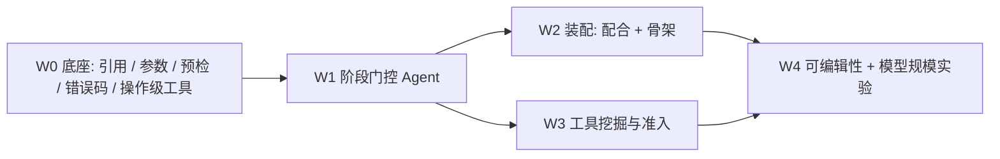

# 实施路线、CAD-1K 使用方式与论文 / Benchmark 计划

> 第三份报告。承接《项目分析与通用化改进及LLM评测方案》（评测问题）与《工程师工作流动作空间与创新定位》（创新叙事），回答三件事：
> 1. 创新报告里的 W0–W4 具体改哪些文件、现在做到哪一步；
> 2. CAD-1K（`markov-ai/cad-1000-hours`）怎么用、不怎么用；
> 3. 如何把系统和 benchmark 写成一篇 CVPR 投稿，先 Text2CAD、后三视图。
>
> 日期：2026-09-28。

---

## 0. 结论先行

- **定位不变**：动作空间是「工程师 workflow」，不是 CadQuery 程序，也不是裸 COM。论文的核心实验是**只改动作空间**（L0–L4）的消融，外加可编辑性评测。
- **本轮已落地**（均已 push）：C# 服务拆分、打开/导出/草图统计接口、评测打分 v2、多轮评测泄题修复、workflow L1 的三个纯 Python 模块、CAD-1K 下载与特征树提取。
- **CAD-1K 只用于挖掘与分析**，不进测试集：license 未声明、可能被模型见过，而且它的交付物包含工程图，与我们的 Text2CAD 任务不同构。
- **Benchmark 的可信度问题先于规模问题**：本轮修掉了三处会让分数虚高或测不出能力的缺陷（自证式执行分、依赖服务端元数据的细节分、GT 目标值泄给 LLM），扩题之前必须先有这些。

### 指导原则：面向没见过的零件

- 目标是做出真正能给工程师用的 AI 辅助 CAD 产品，而不是只会建我们自己那几个测例的系统。每一项改动都以"对没见过的零件是否有帮助"来判断。
- 任何修改都不针对特定测例优化：不把某题的答案、标准步骤或对象名写进 prompt、工具、路由或运行时代码；失败按能力类别归因，用最小的通用机制修复。
- 经常测试系统从未跑过的新测例，并持续扩充 benchmark，覆盖不同的特征类型、尺寸范围和描述方式。
- Agent 建模是多轮闭环的：像 Claude Code 一样调用工具、读取真实结果（特征树、几何、报错）、思考、调整、再继续，直到零件被验证。不局限于一次性规划，单轮只作为基线保留。
- 保留一个从不用于调 prompt、工具或代码的 held-out 测试集；新增测例时先写好需求与 GT，再看当前系统表现，避免按系统能力"出题"。

---

## 1. 本轮完成情况

| 提交 | 内容 | 对应问题 |
|---|---|---|
| `74a75c1` | `SwCommands.cs`（7.4k 行）按职责拆成 9 个 partial 文件；新增 `/api/open-part`、`/api/export-step` | W0 可维护性；CAD-1K 需要打开外部零件；离线几何评测需要 STEP |
| `27bc1f5` | `.gitignore` 排除 `datasets/cad1k/raw/**`；CAD-1K 下载器 | 数据无 license，不得入库 |
| `76e20b4` | 评测 v2：`eval/metrics.py`、`/api/sketch-stats`、`--repeats`、pass@k、bootstrap CI | 打分可被刷、对外部模型不可用 |
| `1f52d0d` | `planner/milestone_view.py`：评测时隐藏里程碑目标值；三视图验收只看 GT | 泄题、自证式验收 |
| `5babcc0` | `planner/workflow/`：参数表、语义面引用、草图预检；C# 面法向改为外法向；CAD-1K 特征提取 | W0 的引用与预检底座 |

### 1.1 评测 v2 修了什么

旧打分（保留为 `score_case_v1`，结果 JSON 的 `v1` 字段）有三个问题：

1. **执行分自证**：成功步数 ÷ 模型自己计划的步数。计划写得越短越容易满分。
   v2 改为「有效实体 15 分 + 稳健性 10 分（每个失败步骤扣 2.5）」，不再用模型自报的计划做分母。
2. **细节分依赖服务端元数据**：拉伸/切除数、圆孔数来自服务在建模时记下的 `feature_sketch_links`，外部打开的零件没有这份数据；旋转、多边形按「成功调用了几次该操作」计数，与最终几何无关。
   v2 只读真实特征树（`GetTypeName2`）和新接口 `/api/sketch-stats` 返回的真实草图几何（直线/圆弧/整圆/构造线、正多边形识别、草图被哪个特征消费）。
3. **没有方差**：单次冷启动的分数不稳定。v2 支持 `--repeats k`，报告 pass@1、pass@k（无偏估计）和按 case 的 bootstrap 95% CI。

一个实现细节：SolidWorks 对「面上拉伸」的凸台和切除都报 `ICE`，所以 `classify_feature` 对 `ICE` 再看特征名（`Cut`/`切除` 与 `Boss`/`凸台`）。中英文版本 SolidWorks 都已验证。

### 1.2 泄题与自证修了什么

- 装配类评测（齿轮箱、缝纫机等 7 个）把 GT 期望坐标、齿轮比写进 milestone 的 postconditions，旧代码 `current_milestone.model_dump()` 把它们原样发给 LLM，修复模式下 `evidence` 还附带目标值。
  现在 `MultiTurnAgent(hide_targets=True)`：LLM 只看到条件类型和描述性参数（keyword、path），evidence 只保留实测值和「偏大/偏小/不足/不匹配」方向。单测直接截获发给 provider 的 prompt，断言 GT 数值不出现。
- 三视图评测的验收原来要求 `status == "completed"`，而这个状态来自模型自己生成的 blueprint 验证。现在验收只看几何与 GT，`process_completed` 单独记录为过程信号。
- **影响**：修复后的三视图通过率和装配通过率与历史结果不可直接比较，重跑后需要在结果里注明版本。

### 1.3 workflow L1 的纯 Python 底座

| 模块 | 作用 | 错误码 |
|---|---|---|
| `params.py` | 驱动参数表，表达式受限 AST 求值，依赖排序与环检测；mm 存储、下发时换算米；`substitute()` 把操作参数里的 `"=L-2*margin"` 替换为数值 | `PARAM_*` |
| `refs.py` | 语义面引用：`top/bottom/...`、`face(+X, outermost/innermost/largest/smallest)`、`face#i`、命名引用；命名引用按几何签名在重建后重新定位；可直接转成现有的 `select_observed_face_and_sketch` | `REF_*` |
| `sketch_check.py` | shapely 预检：闭合、自交、退化、轮廓相交、内外环嵌套推断、最小壁厚/边距、是否落在面边界内 | `SKETCH_*` |

`refs.py` 的单测暴露了一个真实问题：服务端原来返回的平面法向是曲面法向（`PlaneParams`），不保证朝外；用「面中心相对包围盒中心」判断侧别，在「薄底板 + 高凸台」时会把底板顶面判到下侧。已改为 C# 返回 `IFace2.Normal`（实体外法向），引用解析只看外法向。

### 1.4 workflow 层（L1）与闭环 Agent

L1 已经接入运行时（`/api/run` 的 `action_level: "L1"`，评测脚本 `--action-level L1`）。它不是一次性输出整份计划，而是像 Claude Code 一样的闭环：模型调用一个或几个工具 → 拿到真实结果（体积变化、包围盒、报错与回滚信息）→ 思考、调整 → 继续，核对无误后调用 `finish`。

**设计依据是 L0 基线的真实失败**，而不是某一道题。18 次失败步骤可以归成四类通用问题，L1 分别用一个通用机制处理：

| L0 失败类别 | 例子 | L1 机制 |
|---|---|---|
| 实体面上的草图坐标轴写错 | 法向为 Y 的面上把圆心写在 cz | 每个平面固定 (u,v) 坐标，数值即模型坐标；工具负责换算到 SolidWorks 草图坐标（基准面的符号翻转在真机上实测） |
| 同一草图里轮廓互相重叠 | 圆头与矩形杆身画在一张草图里 | shapely 预检在调用 SolidWorks 之前拒绝，并提示拆成两个特征或合并为一个 polygon |
| 切除方向朝外、切不到材料 | 在基准面上向实体外侧切除 | `cut` 默认朝实体内部；基准面位于实体中间时自动两侧切除；执行后校验体积必须减少 |
| 回转轮廓无效 | 轮廓跨过旋转轴 | 预检轮廓必须位于轴线一侧 |

**工具集**（`planner/workflow/tools.py`）：`get_model_state`、`set_parameters`、`extrude`、`cut`、`hole`、`revolve`、`fillet`、`chamfer`、`circular_pattern`、`linear_pattern`、`delete_feature`、`finish`。单位 mm；数值参数可以写成 `"=表达式"` 引用驱动参数；平面参数接受基准面名、语义面引用（`top`、`face(+X, innermost)`）或 `face#index`。

**每个特征工具都是一个事务**：参数求值 → 解析平面 → 草图预检 → 执行原子操作 → 校验体积变化（凸台必须增加、切除必须减少）。任何一步失败，工具都会删除本次新建的草图和特征，模型回到调用前的状态，并返回错误码和修复提示。这依赖新增的 C# 接口 `/api/delete-feature`。

**顺带修掉的 C# 问题**：
- `FeatureCut4` 的第二个参数 `Flip` 是「反转切除侧」（保留轮廓外的材料），第三个参数 `Dir` 才是反转方向；旧代码把 `flipDirection` 传给了 `Flip`。L0 里凡是用 `flipDirection` 的切除都受影响，因此 L0 在 dev 集上按新服务重跑，不直接沿用旧基线。
- 面观测补充了包围盒（用于预检轮廓是否落在面上）和圆柱面的半径、轴线（用于识别孔和轴）。

**评测侧**：新增 12 道 held-out 文本题（`--split heldout`），规格与 GT 在系统首次运行前写定；细节项只要求任何合理建模路线都会产生的结构（新增指标 `solid_features`），不把某种建法当作标准答案。L1 的 `results` 只列建模工具调用，失败的调用照样按 v2 规则扣稳健性分，即便 Agent 之后修正了。

---

## 2. W0–W4 实施路线（落到文件）

### W0：底座（进行中）

| 项 | 文件 | 状态 |
|---|---|---|
| C# 拆分 | `Chapter1.ConnectToSw/SwCommands.*.cs` | 完成 |
| 打开 / 导出 STEP / 草图统计 | `SwCommands.Document.cs`、`SwCommands.Query.cs`、`Program.cs` | 完成 |
| 参数表、语义引用、草图预检、错误码 | `LLMPlanner/planner/workflow/` | 完成（纯 Python） |
| 操作级接口 | 按 CAD-1K 使用频率排序：镜像、参考基准面、筋、孔（孔向导 + 草图切除两种展开）、抽壳；`SwCommands.Features.cs` 新增端点，`schemas.py` 增加 `OperationType` | 待做 |
| 参数表落到 SolidWorks 方程式 | `SwCommands.Features.cs` 增加 `/api/equation`（`IEquationMgr.Add3`），让尺寸真正受全局变量驱动 | 待做 |
| 工具层 | `planner/workflow/tools.py`、`frames.py`、`profiles.py`、`agent.py`：12 个工程师级工具 + 闭环 Agent，见 §1.4 | 完成首批；抽壳、镜像、筋、参考基准面待补 |

### W1：阶段门控 Agent

- 新文件 `planner/workflow/stages.py`：Spec → Skeleton → Base → Secondary → Detail → Check。每个阶段只暴露本阶段的工具子集，出阶段要过门禁（例如 Base 结束时必须有唯一实体、包围盒在 Spec 范围内）。
- `planner/workflow/spec.py`：从用户描述抽取参数表和需求清单（Spec），需求清单只用于**过程门禁**，不用于评分（评分只用独立 GT）。
- `planner/workflow/agent.py`：L1/L3 执行器；旧 `agent_loop.py` 保留为 L0 基线。
- `web/app.py` 的 `/api/run` 与 `eval/eval_text_singleturn_qwen.py` 增加 `action_level`（`L0|L1|L3|L4`）。

### W2：装配

- 配合驱动定位：`mate(concentric, A.axis, B.hole)`、`mate(coincident, A.face(+Z), B.face(-Z))`，坐标不进入 prompt。
- 骨架零件 / 布局草图作为共享参考。
- 评测已经完成去泄题（1.2 节），W2 只需再补「配合语义正确」的检查（例如齿轮副用齿轮配合而不是固定）。

### W3：工具挖掘与准入

> 已由 [RSI自我进化规划](RSI自我进化规划.md) 取代：准入改为在 val 族生成题上做 A/B、并要求 dev 无回归，held-out 只报告、不参与准入。以下为原始计划。

- 输入：L0/L1 成功轨迹 + CAD-1K 的特征序列统计（只用来提示候选，不进运行时）。
- 流程：挖高频子序列 → LLM 提议带参数的工具 → 回归集执行成功 → held-out 上降低步数或失败率才入库 → 覆盖率曲线。
- 文件：`planner/workflow/library/`（候选、已准入、淘汰记录）和 `eval/eval_tool_admission.py`。

### W4：可编辑性与模型规模

- 可编辑性：对完成的模型追加一句修改（「底板加长 20mm」「孔径改 M8」），测再生成功率与未改区域的几何保持（STEP 局部 IoU）。依赖 W0 的方程式与命名引用。
- 模型规模：同一 L3/L4 动作空间下对比大模型与 7B–30B 模型，验证「化繁为简降低门槛」。

---

## 3. CAD-1K 的使用方式

### 3.1 数据是什么

`markov-ai/cad-1000-hours` 的 SolidWorks 子集共 114 个任务、约 101 小时录屏。每个任务包含：

- `task_desc.json`：任务描述（多为「建模 + 出工程图」）；
- `rubrics.json`：原子化需求（平均 6.5 条/任务，其中平均 0.6 条涉及工程图，其余是模型需求）；
- `narration.json`：带时间戳的动作 / 意图 / 细节标注（每任务数百段）；
- `frame_events.json`：屏幕像素级事件（每个约 75MB，默认不下载）；
- `output_files/`：交付的 `.sldprt`（装配任务为 `output.sldasm` + `output_N.sldprt`）、`.slddrw`、`.pdf`；
- `clip.mp4`（约 160MB/任务，不下载）。

数据集**没有声明 license**。按「只在本地分析、不再分发」处理：原始文件在 `datasets/cad1k/raw/`（gitignore），仓库只提交派生统计 `datasets/cad1k/stats.json`。正式写进论文前需要联系 markov-ai 确认使用许可。

### 3.2 已经做的

- `datasets/cad1k/download.py`：只下载 JSON / PDF / SolidWorks 文件，可断点续传。
- `datasets/cad1k/extract_features.py`：用 C# 服务逐个打开交付零件，导出特征树、真实草图几何、面、包围盒、体积和 STEP；把特征名与 narration 片段做粗对齐（`alignment.json`）；把 narration 按动作类型分类计时；汇总成 `stats.json`。

### 3.3 初步统计

全部 114 个任务已下载（146.6 MB，不含视频与像素事件）并完成提取，完整结果在 `LLMPlanner/datasets/cad1k/stats.json`。

**覆盖情况**

| 项 | 数值 |
|---|---|
| 任务 | 114（其中装配任务 7 个） |
| 交付零件 | 149 个，SW2025 成功打开 147 个 |
| 打不开的零件 | 2 个，均为 `future_version`（由更新版本的 SolidWorks 保存） |
| 每零件实体特征数 | 平均 6.3，中位数 6，最大 21 |
| 录屏时长 | 平均 53 分钟/任务，中位数 44 分钟 |
| 特征名能在 narration 中找到的比例 | 83.7% |

**特征使用分布**（147 个零件，不含草图和默认基准面）

| 类别 | 特征数 | 用到的任务数 |
|---|---|---|
| 拉伸凸台 | 337 | 101 |
| 切除（拉伸/旋转/扫描切除） | 266 | 86 |
| 用户新建基准面 | 94 | 48 |
| 圆角 | 93 | 41 |
| 镜像 | 40 | 22 |
| 旋转 | 33 | 18 |
| 筋 | 16 | 13 |
| 倒角 | 16 | 11 |
| 孔向导 | 12 | 6 |
| 扫描 / 放样 | 14 | 12 |
| 抽壳 | 2 | 2 |
| 线性/圆周阵列 | 1 | 1 |

草图层面：147 个零件共 682 个整圆，其中 288 个位于被切除特征消费的草图里；另有 385 条构造线、21 个槽口、9 个正多边形。

**高频特征二元组**：拉伸→拉伸（109）、拉伸→切除（99）、切除→切除（98）、基准面→拉伸（52）、拉伸→基准面（48）、切除→拉伸（37）、圆角→圆角（34）、拉伸→圆角（29）、基准面→筋（15）、拉伸→镜像（13）。

**narration 时间占比**（按关键词粗分类，114 个任务平均）：尺寸与几何约束 26.6%，画草图 20.2%，工程图 13.6%，拉伸 6.6%，视图操作 4.2%，编辑已有特征 3.6%，孔 3.2%，圆角/倒角 2.2%，切除 2.1%，撤销/删除 2.0%，镜像/阵列 2.0%，参考几何 1.8%，其余合计约 12%。

**对系统设计的直接启示**

1. **人类工程师近一半时间花在草图与约束上**（26.6% + 20.2%），真正「点特征按钮」的时间只有约 20%。这支持把工具层的重点放在「草图 + 尺寸驱动」的聚合（参数表、预检、语义引用），而不是再堆更多特征类型。
2. **孔向导很少用**（12 个），圆孔绝大多数是「草图画圆 + 拉伸切除」（288 个圆）。`hole_pattern` 工具应同时支持两种展开，默认用可编辑性更好的孔向导，但评测不能要求必须用孔向导。
3. **阵列几乎不用，镜像常用**（1 对 40），而用户新建基准面很常见（94 个，48 个任务）。W0 的操作级工具优先级应调整为：镜像、基准面、筋，先于阵列。
4. **分布高度集中**：924 个实体特征中，扫描、放样、抽壳、阵列合计 17 个（不到 2%），筋 16 个（1.7%）。L1/L3 工具覆盖拉伸、切除、圆角、倒角、镜像、基准面、旋转、孔这 8 类，即可覆盖约 97% 的特征，其余回退到原子 API。这个比例可以作为论文里「工具库覆盖率」的外部参照。

### 3.4 怎么用

1. **工具库挖掘的先验（W3）**：特征类别的二元组（如「拉伸 → 切除」「切除 → 圆角」）和各类特征的任务覆盖率，决定 W0/W3 先做哪些工具。只用于排优先级和提议候选，不把任何零件的尺寸写进运行时。
2. **阶段划分的证据（W1）**：narration 的时间占比能直接说明工程师在草图、约束、特征、检查、返工上的时间分配，为 Spec → Skeleton → Base → Secondary → Detail → Check 的阶段设计提供人类证据，也可以作为论文的动机图。
3. **动作空间覆盖率**：统计 CAD-1K 交付零件中有多少比例的特征能被 L1/L3 工具表达，作为「工具库覆盖率」的外部参照。
4. **不做的事**：不作为测试集；不用它训练模型；不把 rubrics 改写成我们的 benchmark 题目（避免 license 与污染问题）。

### 3.5 已知限制

- 部分交付零件由更新版本的 SolidWorks 保存（打开错误码 `swFutureVersion = 8192`），本机 SW2025 打不开，统计中单独列出。
- 装配任务里各零件的特征名互相重复（每个零件都有 `Boss-Extrude1`），按名对齐只作参考。
- narration 是自动生成的自然语言标注，动作分类用关键词规则，误差需要抽样人工核对后再写进论文。

### 3.6 workflow 挖掘（第二轮）

脚本 `datasets/cad1k/mine_workflows.py`，输出 `datasets/cad1k/workflows.json`（只含计数和任务 id）。在 3.3 的基础上多用了三类信号：

- **带轮廓签名的特征序列**：每个实体特征附上它消费的草图的几何签名（单圆、多圆、纯直线、槽口、直线+圆弧混合、正多边形、是否带构造线），再统计 n-gram 和工程 motif；
- **narration 细粒度操作**：草图工具、终止条件、参考几何、孔、编辑、检查等 42 种操作，按任务数计支持度（排除工程图片段）；
- **rubric 设计意图**：通孔、沉头孔、节圆均布、筋板、键槽等 21 类工程语义。

另外发现 3.3 的分类器漏掉了两类特征：钣金（基体法兰 / 边线法兰 / 折弯 / 断角，约 5 个任务）和 `SweepThread` 螺纹（15 个，7 个任务）。

**A. 要补的 L1 原语**（按证据强弱排序）

| 优先级 | 工具 / 能力 | 证据 |
|---|---|---|
| 1 | 轮廓里的圆弧、切线弧和角部圆角（圆角矩形、腰形、耳片外形） | 被消费草图里「直线+圆弧混合」签名最常见：`PLANE→EXT[mixed]` 17 个任务，`EXT[mixed]→EXT[mixed]` 8 个；narration 里草图圆角 30 个任务、切线/三点弧 13 个 |
| 2 | 参考基准面（偏移 / 角度 / 过点） | 94 个特征 48 个任务；`PLANE→EXT` 35 个任务 52 次；`EXT→PLANE→EXT` 23 个任务 |
| 3 | 终止条件：mid-plane、through-all、up-to-surface/next、双向、薄壁 | narration 分别出现在 50 / 46 / 32 / 17 / 11 个任务 |
| 4 | 镜像（特征 / 实体，关于基准面或平面） | 40 个特征 22 个任务；narration 47 个任务；`EXT→MIR` 10 个任务 |
| 5 | 筋 | 16 个特征 13 个任务，其中 12 个任务是「先建基准面再画筋」；rubric 里 rib/gusset/web 出现在 45 个任务 |
| 6 | 编辑已有特征（改尺寸、改草图后重建） | narration「edit sketch / edit feature」84 个任务，undo / delete 96 个任务。人类返工是常态，目前我们只有删除，没有编辑 |
| 7 | 孔：沉头 / 沉孔 / 螺纹孔（含装饰螺纹） | rubric 通孔 82、沉头 9、螺纹 5 个任务；`SweepThread` 7 个任务 |
| 8 | 扫描 / 放样 / 旋转切除 / 抽壳 / 拔模 | narration 分别出现在 12 / 7 / – / 16 / 9 个任务；`REVCUT` 在法兰轴承座类零件里反复出现 |
| 9 | 钣金 | 约 5 个任务，单独成族，优先级最低 |

**B. 宏 workflow 候选（L4 挖掘对象）**

| motif | 支持度 | 对应宏工具 |
|---|---|---|
| 同一草图同心圆拉伸出管 / 套 | 36 个任务，54 次 | `tube(od, id, length)` |
| 先实体后一串减料细节（`EXT→CUT→CUT→CUT`） | 79 个任务有此结构，4-gram 18 个任务 | 阶段门控的 Base→Detail 本身 |
| 在偏移 / 角度基准面上加凸台（斜支管、侧耳、侧凸台） | 35 个任务，52 次 | `branch_boss(on_plane(angle/offset), profile, up_to_body)` |
| 一个草图里 ≥3 个圆一次切除（孔组、节圆孔） | 23 个任务，34 次 | `hole_group(pcd / grid / list)` |
| 绕中心线旋转的台阶轮廓 | 16 个任务，29 次 | `stepped_revolve(segments)` |
| 基准面上画开放轮廓成筋 | 12 个任务，15 次 | `gusset(between face A, face B, thickness)` |
| 结尾一串圆角 / 倒角 | 12 个任务 | `finish_edges(rules)`，Detail 阶段 |
| 做一半再镜像 | 10 + 6 + 5 个任务（EXT / PLANE / CUT → MIR） | `mirror_half(plane)` |
| 凸台 + 同心孔（`EXT[circle]→CUT[circle]`） | 12 个任务 | `bossed_hole(od, id, depth)` |
| 沿路径扫出弯管再加两端法兰 | 9 个任务 | `pipe_elbow(path, od, id)` + 法兰 |

**C. 过程层面的 workflow**（这些不是工具，是 agent 的工作方式）

- **草图完全定义**：约束和尺寸的时间占比最大（2017 段，约 387 分钟，全部 114 个任务都出现）。我们用参数表达式和规范坐标系替代手工约束，这是 L1 省掉人类时间的主要来源，论文里可以用这个数做动机。
- **测量 / 质量属性检查**：83 个任务。对应 L3 的 Check 阶段（包围盒、体积与规格对照）。
- **模型剖视检查**：27 个任务。可以作为一个只读观察工具（给 agent 看剖面尺寸）。
- **返工**：undo/delete 96 个任务、edit 84 个任务。支持保留事务回滚，并补上「编辑特征」工具。

**口径说明**：narration 用关键词规则匹配，「angled plane」这类规则可能混入视图旋转，数值偏高，写进论文前要抽样人工核对；motif 基于特征顺序和草图几何计数，不含草图的空间关系。

### 3.7 复杂零件与 demo 候选

`mine_workflows.py --show-examples` 按「实体特征数 + 2×特征种类 + 0.1×面数」给零件排序。下表是排序靠前、参考图清楚的零件（原图在 `raw/{id}/input_files/`）。**CAD-1K 只用于挖掘**，demo 应按同一类零件自己写题、自己定尺寸，不直接搬用原题（也规避 license 问题），更不能进 benchmark。

| 零件族（CAD-1K 参考 id） | 看点 | 需要的能力 | 现在能做吗 |
|---|---|---|---|
| 叉头 / 拉杆端（f6320756） | 台阶旋转体 + U 形开口 + 横向销孔 | 旋转、切除、孔 | 基本能，作为第一个 demo |
| 带侧向接口的台阶壳体（b927c32b） | 旋转台阶轮廓 + 法兰 + 对称侧凸台 | 旋转、侧面凸台、孔 | 基本能 |
| 三耳法兰轴承座（797f5af1） | 中心轮毂 + 三个圆弧耳片 + 节圆孔 + 沉台，外观漂亮 | 圆弧轮廓、圆周阵列、孔组、螺纹孔 | 需要轮廓圆弧 |
| 轴承支座 / 枕块（b24720cb） | R66 圆弧侧板 + 顶部 U 槽 + 底板孔，工程味强 | 圆弧轮廓、镜像、筋 | 需要圆弧和镜像 |
| 双臂摇杆（e59efd3c） | 165° 折弯双臂 + 中心轮毂 + 开槽臂 | 角度基准面、槽口、镜像 | 需要基准面和镜像 |
| 立柱底座壳体（ff1753ee） | 圆柱主体 + 法兰 + 三个方向侧凸台 + 交叉通孔 + 螺纹孔，剖视很炫 | 基准面、up-to-body、孔组、螺纹孔 | 需要基准面和终止条件 |
| 法兰弯管（06e5b82d / 69840c82） | 90° 扫描弯管 + 两种法兰 | 扫描、抽壳或同心轮廓 | 需要扫描 |
| 手轮（dddde982） | 110 mm 波浪外缘 + 5 个窗口辐条 + 轮毂方孔 + 大量圆角，最「炫」 | 圆弧轮廓、圆周阵列、大量圆角 | 最难，作为压轴 demo |

建议的 demo 路线：先做叉头和台阶壳体（现有工具）；补上轮廓圆弧、基准面、镜像后做法兰轴承座、枕块、摇杆；补上扫描后做法兰弯管；最后做手轮。每做完一个 demo 族，就按同族另写 1–2 道新题加进 held-out（先写 GT 再运行），这样 demo 能力的提升也能在 benchmark 上被测到。

---

## 4. 论文与 Benchmark 计划

### 4.1 论文主张

> 商业 CAD 的难点不在几何，而在繁琐的 API 与专业流程。把动作空间从原子 API 提升到「工程师 workflow」（阶段门控 + 工程语义引用 + 经过验证的工具库），能在不换模型的前提下显著提高成功率、降低成本，并产出可编辑的原生模型。

对应的三组实验：

1. **动作空间消融（主表）**：同一任务集、同一组模型，L0 / L1 / L3 / L4（L2 CadQuery 作为外部对照）。
2. **模型对比**：在 L0 与 L3/L4 下分别比较多家 LLM，展示「系统带来的提升」与「模型之间的差距」是两回事。
3. **可编辑性**：修改指令后的再生成功率与局部几何保持，这是 CadQuery 生成与裸 COM 路线都不自然具备的。

### 4.2 Benchmark 设计

| 维度 | 设计 |
|---|---|
| 任务 | Text2CAD 先行：现有 15 题扩到 100–150 题，按零件类别和难度分层（单特征 / 多特征 / 带阵列与孔 / 薄壁壳体）；之后三视图（现有 5 题扩到 50+），再到装配 |
| GT | 每题有独立 GT：包围盒、体积区间、特征类别下限、关键尺寸；逐步补 STEP 真值做 IoU / Chamfer 距离。GT 不进入任何 prompt |
| 划分 | dev（用于工具挖掘与调参）/ test（只在最终评测时跑），工具准入只看 dev |
| 指标 | 严格通过率、v2 分数、pass@1 / pass@k、需求满足率、IoU；过程指标：步数、token、花费、修复轮数、回退到原子 API 的比例 |
| 协议 | 冷缓存；每题 k=3 次；报告 bootstrap 95% CI；同一时间段、同一 SolidWorks 版本 |
| 模型 | 通过 AI Ping 统一接入的多家模型（Qwen、GLM、Kimi、DeepSeek 等），加一两个 7B–30B 小模型 |

### 4.3 先 Text2CAD、后三视图的理由

- Text2CAD 的 GT 最容易做到独立、无歧义，评测 v2 已经可用；
- 三视图额外引入视觉识读误差，应当在动作空间的收益已经在文本上被证明之后再加，才能把「视觉错误」与「建模错误」分开统计（三视图评测已记录 vision IR，可以做这一拆分）。

### 4.4 时间线

CVPR 截稿通常在 11 月中旬（具体日期以官网为准）。按此倒排，时间很紧，优先级如下：

| 周 | 目标 |
|---|---|
| 第 1 周 | L0 基线用 v2 重跑（15 题 × 多模型 × k=3）；Hole/Shell/Mirror 与方程式接口；工具层首批 6 个工具 |
| 第 2 周 | 阶段门控 Agent（L3）；Text2CAD 扩到 60 题并写 GT |
| 第 3 周 | L0 vs L3 主表；可编辑性评测第一版；CAD-1K 统计图 |
| 第 4 周 | 工具挖掘与准入（L4）第一版；Text2CAD 扩到 100 题 |
| 第 5 周 | 三视图子集；小模型实验；消融补齐 |
| 第 6 周 | 写作与补实验 |

如果时间不够，L4（库学习）可以降级为「小规模验证 + 覆盖率曲线」，主张落在 L0→L3 的动作空间消融与可编辑性上；三视图可以作为扩展实验。

### 4.5 风险

- **SolidWorks 单实例**：评测只能串行，每题 20–60 秒。100 题 × 5 模型 × 3 次 × 2 档约需 25 小时机时，需要提前排队或加第二台机器。
- **API 余额**：每次 Text2CAD 调用约 0.02 元（Qwen3.5-397B），整轮主表约数十元量级，可控；多轮与装配贵一个数量级。
- **与已有工作的区分**：投稿前需要再做一次文献检索，确认 library learning 用在商业 CAD 原生 API 上仍是空白；即便有相近工作，差异也应落在「原生可编辑模型 + 阶段门控 + 工程语义引用」。

---

## 5. 下一步

1. L0 基线已用 v2 重跑（附录 A），后续所有对比以它为起点；下一步把同一协议扩到 GLM、Kimi 等模型；
2. W0 剩余项：镜像、基准面、筋、孔、抽壳等操作级接口，方程式接口，工具层；优先让「在已有面上草图 + 切除」走语义引用和预检；
3. 阶段门控 Agent 与 `action_level` 开关，跑出第一张 L0 vs L3 对比表。

---

## 附录 A：L0 基线（v2 打分）

设置：15 道 Text2CAD 题，每题冷缓存跑 2 次；单轮模式（L0）；Qwen3.5-397B-A17B，经 AI Ping 调用。共 30 次运行，耗时 14 分钟，花费 ¥0.78，约 42 万 token。结果文件：`LLMPlanner/eval/text_singleturn_qwen_v2_baseline.json`（含完整 trace，可用 `--rescore` 离线重算）。

| 指标 | v2 | v1 |
|---|---|---|
| 平均分 | 70.6（95% CI 53.6–87.0） | 71.6 |
| 严格通过 | 12/30 | 11/30 |
| pass@1 / pass@2 | 0.40 / 0.47 | — |

| 题目 | v2（两次） | v1（两次） | v2 通过 | 主要失分 |
|---|---|---|---|---|
| 一体式手机支架 | 64 / 74.4 | 47.3 / 57.5 | 0/2 | 步骤失败、尺寸、体积、切除数、圆角 |
| 四脚板凳 | 100 / 100 | 100 / 100 | 2/2 | — |
| 圆角板凳 | 97.5 / 100 | 90 / 100 | 2/2 | 步骤失败（最终几何正确） |
| 收纳盒 | 100 / 77.5 | 100 / 69.6 | 1/2 | 步骤失败、体积 |
| 标准骰子 | 100 / 91.9 | 100 / 81.1 | 1/2 | 步骤失败、切除数 |
| 六角螺母 | 100 / 100 | 100 / 100 | 2/2 | — |
| 马克杯 | 84.7 / 0 | 84.7 / 8.9 | 0/2 | 第 1 次用旋转建模（尺寸体积都对，但题目要求拉伸）；第 2 次无实体 |
| 扳手 | 0 / 0 | 29.2 / 29.2 | 0/2 | 无实体 |
| 花瓶 | 83.1 / 0 | 78.1 / 31.3 | 0/2 | 步骤失败；第 2 次无实体 |
| 钥匙 | 0 / 0 | 10 / 10 | 0/2 | 无实体 |
| 齿轮盘 | 100 / 100 | 100 / 100 | 2/2 | — |
| 法兰盘 | 88.1 / 89.7 | 82.8 / 83.2 | 0/2 | 螺栓孔切除失败，圆孔数不足 |
| 皮带轮 | 60.8 / 60.8 | 54.3 / 54.3 | 0/2 | 切除失败、倒角、体积 |
| 三段阶梯轴 | 100 / 100 | 100 / 100 | 2/2 | — |
| 内六角螺栓 | 72.5 / 72.5 | 71.8 / 73.2 | 0/2 | 六角孔切除失败 |

**解读**

1. **v2 与 v1 平均分接近，但分数分配更合理**：没有实体的运行（6/30）在 v2 下得 0 分，v1 仍按「成功步骤比例」给 10–29 分；最终几何正确、只是中途有一步失败的运行，v2 只扣 2.5 分，v1 按计划步数比例扣得更多。
2. **置信区间很宽**（±17 分）：15 道题不足以区分模型，这直接支持把 Text2CAD 扩到 100 题以上。
3. **失败集中在「在已有面上操作」**：18/30 次运行至少有一步失败，失败的操作中切除拉伸 7 次、拉伸 5 次、圆角 2 次、旋转 2 次；典型报错是「草图不在实体面上」和「射线未命中实体面」。这正是 W0 语义面引用与草图预检要解决的问题，也是 L0 → L1 消融最可能拉开差距的地方。
4. **GT 的写法本身有偏**：马克杯第 1 次用旋转建出了尺寸、体积都正确的杯子，却因为题目细节要求「拉伸 ≥ 2」而判失败。细节要求应改为与建模方法无关的几何量（例如圆柱面数、通孔数、壁厚），这是扩题时要统一修订的一点。
5. **打分修订记录**：首次运行后发现 v2 会统计「画了但没被任何特征使用」的草图（如切除失败后残留的六边形草图），已修正为只统计被特征消费的草图，并用 `--rescore` 从 trace 重算。上表为修正后的分数（修正前平均 71.5）。
6. **严格朝向模式暂不可用**：用 `--strict-orientation` 重算只有 1/30 通过，因为现有 GT 的包围盒没有规定朝向。要启用严格模式，需要先在 GT 中写明朝向约定。

## 附录 B：本轮执行计划原文

执行计划另存于 `docs/CAD-1K下载期间的并行修复计划.md`。
